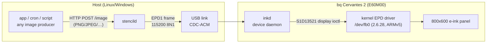
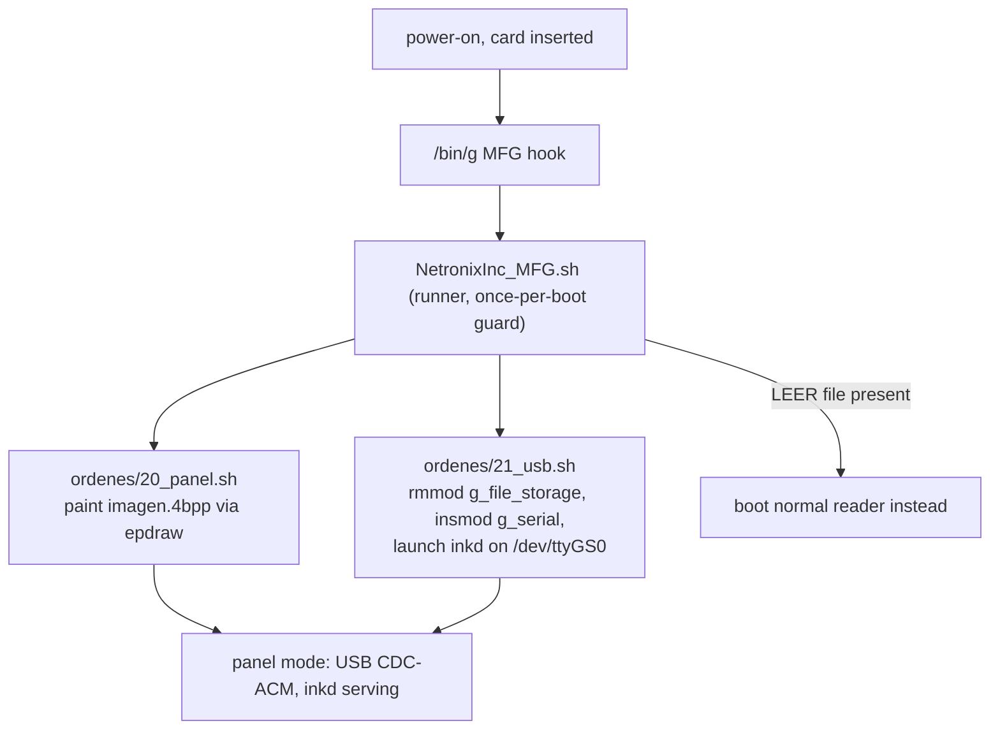

# Architecture

How the Stencild panel system works, end to end. Companion pages:
[apps guide](apps-guide.md) (build content producers), [service API](service-api.md)
(HTTP endpoints + wire protocol), [SD guide](sd-guide.md) (device provisioning),
[CLI reference](cli.md).

## The system in one picture



Two programs carry the whole load:

- **`stencild`** (host side) — HTTP front end. Accepts any common image
  format, converts to the panel's native payload, speaks the EPD1 serial
  protocol over the USB CDC-ACM port. Also: serial autodetection, an inbox
  directory watcher, dry-run frame dumps, installer artifact generation and
  a self-update command.
- **`inkd`** (device side) — a ~4 KB freestanding ARMv5 daemon that lives on
  the init SD card. Reads EPD1 frames from `/dev/ttyGS0` and writes them to
  the display through the kernel's `S1D13521` display ioctl on `/dev/fb0`.
  Built with raw EABI syscalls only (no libc), because the reader's
  glibc/static toolchain combo segfaults on its 2.6.28 kernel.

They are deliberately symmetrical: `stencild` frame encoder
(`crates/stencild/src/frame.rs`) and `inkd.c` reader implement the same
`EPD1` framing, so either side can be replaced or simulated
(`--frame-out` on the host, `--sim:<path>` on the device binaries).

## The panel

| Property | Value |
|---|---|
| Device | bq Cervantes 2 (E60M00) e-reader |
| Panel controller | Marvell M166E EPD (S1D13521-class display ioctl) |
| Glass | 800×600, physically portrait; kernel DC geometry is 800×600 **landscape** |
| Kernel | Linux 2.6.28, ARMv5TE |
| USB | device-mode gadget; stock firmware exposes mass storage, we load `g_serial` (CDC-ACM) |

Content must be authored in **landscape** 800×600; the kernel rotates it
onto the portrait glass (see [apps guide](apps-guide.md)).

## EPD1 wire protocol

One frame over the serial link (little-endian):

```
offset  size  field
0       4     magic "EPD1"
4       4     u32 LE payload size (240000 for a frame, 0 for PING)
8       1     u8 waveform mode
9       1     u8 invert flag
10      N     payload (packed 4bpp grayscale)
```

- Replies are one line: `OK`, `PONG` (to a zero-size PING frame), or
  `ERR <reason>`.
- Payload: exactly 240,000 bytes = 800×600 at 4bpp. Even-x pixel goes in
  the **low nibble**, odd-x in the high nibble, row stride 400 bytes.
  0x0 = black, 0xF = white.
- Waveform modes: `0` INIT, `1` MU, `2` GU (default), `3` GC, `4` NOP.

`stencild` uses the same framing for PING/PONG autodetection: it probes
every serial port at 115200 and adopts the first that answers `PONG`.

## Device boot chain (panel mode)

The init SD card turns the reader into a headless panel **without touching
NAND** — the stock boot logic has a manufacturing hook (`/bin/g`): if
`NetronixInc_MFG.sh` exists in the card root, the stock reader app
(`ebrmain`) never starts and the hook runs as root.



- `epdraw` — one-shot painter for the boot image (same ioctl as `inkd`,
  same freestanding build rules).
- `g_serial.ko` / `g_ether.ko` — stock Linux 2.6.28 USB gadget modules
  redistributed under GPL-2.0; see [THIRD_PARTY](../THIRD_PARTY.md).
- Create a file named `LEER` in the card root to boot the normal reader
  even with the card inserted; remove the card and power-cycle to fully
  revert. See [SD guide](sd-guide.md) for building the card with `sdgen`.

## Host service internals

`stencild` is a single-threaded-per-concern process:

- **HTTP** (`service.rs`): `tiny_http` loop over `GET /health`,
  `POST /image`, `POST /raw`. Image bodies are decoded, resized
  (LANCZOS) to 800×600 grayscale, quantized to 16 levels and packed to
  4bpp before pushing.
- **Serial** (`device.rs`): one `SerialPort` handle behind a mutex;
  each push writes a frame and reads the one-line reply. On failure the
  port is reopened once (single-try reconnect); a push against an offline
  device fails fast with `offline` errors and the next push retries.
- **Inbox watcher**: optional directory (`--inbox DIR`); files that stop
  growing for ~1 s are converted, pushed and moved to `done/`.
- **Dry run**: `--no-device --frame-out FILE` writes the exact EPD1
  frame bytes instead of opening any port — the full pipeline with zero
  hardware.
- **Self-update** (`update.rs`): local `file://` manifest with sha256,
  atomic binary replacement, optional `--selftest` version check.
  Network manifests are rejected by design.
- **Tray** (`tray.rs`): `stencild tray` runs the HTTP service plus a
  resident tray icon (Windows). The menu drives the same service methods
  the HTTP API exposes: Pause toggles a gate in `push_payload`,
  Clear repushes the embedded boot image, Update applies a local
  `manifest.json` (with the running-exe rename dance), and the status line
  refreshes every 2 s. If a serial exchange fails (or the port was never
  opened), the next push makes one bounded reopen attempt, so the service
  self-heals when the device reappears.

## Design rules learned on this hardware

- Freestanding C (`-nostdlib`, raw syscalls) is the only reliable userspace
  on the 2.6.28/glibc pairing — static glibc binaries segfault.
- Every full frame is a full e-ink refresh (~1 s, black/white flash);
  comfortable update cadence is ≥ 10 s. Idle burns nothing: the panel
  retains the last image unpowered.
- The reader's USB controller is only free while `ebrmain` is not running,
  hence the MFG-hook boot flow instead of a reader-app addon.
